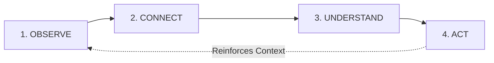
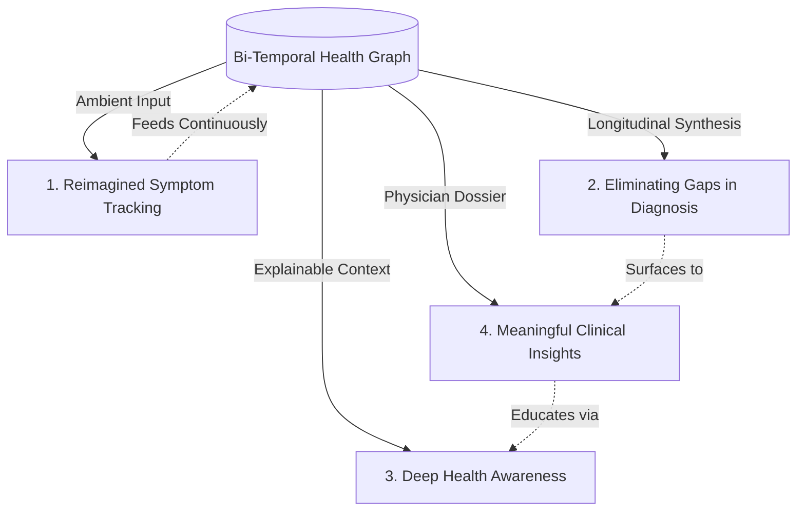

# CONTINUUM: Women's Health Intelligence Platform (WHIP)
## Strategic Product Blueprint & Foundational Architecture
*Prepared for recHERsion 2026 National Hackathon*

---

## 1. Product Vision & Identity

### The Brand & Identity: **Continuum**
> *"Your body does not live in episodes. Your health intelligence shouldn't either."*

**Category Definition:** 
Continuum is not an app, a tracker, or a clinic. It is a **Longitudinal Health Intelligence Engine** designed specifically for female biological complexity. 

### Vision Statement
To eliminate diagnostic delays and health gaslighting for women by transforming lifelong, fragmented biological events into a coherent, dynamic intelligence graph that empowers women and equips physicians with unprecedented longitudinal context.

### Core Mission
To act as the permanent biological memory and pattern synthesizer for women—bridging the chasm between everyday lived physical experience and high-stakes clinical consultations, without ever stepping into unauthorized diagnosis or transactional care.

---

## 2. The First-Principles Re-Framing

Conventional digital health treats women's bodies as either **reproductive calendars** (period trackers) or **acute crisis episodes** (urgent telehealth appointments). 

| The Conventional Broken Paradigm | The Continuum First-Principles Paradigm |
| :--- | :--- |
| **Episodic Data Drops:** Blood test in March, doctor visit in August, ultrasound in November. | **Longitudinal State Space:** Health is a continuous vector evolving across biological time. |
| **Isolated Variables:** A dermatologist sees cystic acne; an endocrinologist sees fasting glucose; a gynecologist sees irregular cycles. | **Cross-Domain Synthesis:** Connects skin, endocrine, metabolic, and menstrual markers into an interconnected biological graph. |
| **User Burden (Active Logging):** Asking tired women to fill out 40 checkboxes every single night. | **Ambient Multi-Modal Observation:** Passive ingestion, conversational voice captures, and zero-effort document parsing. |
| **Presumptuous AI (Diagnostic Hubris):** "You have an 82% chance of Endometriosis." (Dangerous & alienating to doctors). | **Clinical Translation & Pattern Surfacing:** "A recurring multi-system correlation exists between Luteal day 21 and ferritin drops. Here are 3 validated clinical questions for your physician." |

---

## 3. Product Philosophy: The Unbroken 4-Stage Loop

Every technical service, algorithm, and UX interaction in Continuum strictly maps to this unidirectional, iterative lifecycle:



### Stage 1: OBSERVE (The Senses)
* **Principle:** Frictionless, multi-modal ingestion of lived experience and clinical documentation.
* **What happens:** 
  - Ingestion of unstandardized lab reports (PDFs, photos of CBCs, thyroid panels).
  - Ambient micro-voice logs ("Woke up with lower back cramping on day 18; heavy brain fog since yesterday").
  - Wearable baseline feeds (resting heart rate variability, basal temperature deltas, sleep fragmentation).
  - Life events & interventions (started spironolactone, changed shifts at work, stopped hormonal IUD).
* **Guiding Rule:** Zero mandatory forms. No punitive streaks. The system observes without judgment.

### Stage 2: CONNECT (The Graph)
* **Principle:** Grounding events in **Bi-Temporal Coordinates**.
* **What happens:**
  - Events are mapped on two distinct temporal axes:
    1. **Chronological Time:** Date, month, year (e.g., October 2024 vs. October 2026).
    2. **Endocrine/Biological Phase Time:** Day of menstrual cycle, postpartum week, or perimenopausal transition phase.
  - Entities (e.g., `Serum Ferritin`, `Joint Pain`, `Luteal Phase Defect`, `TSH Level`) are linked in a personalized **Biomedical Knowledge Graph**.
* **Guiding Rule:** An isolated lab value is meaningless; its relationship to a cycle phase and lifestyle intervention creates intelligence.

### Stage 3: UNDERSTAND (The Pattern Engine)
* **Principle:** Longitudinal pattern inference without diagnostic speculation.
* **What happens:**
  - The AI computes moving cross-correlations over 90, 180, and 720 days.
  - Detects silent sub-clinical drifts (e.g., a gradual 1.8-point creep in HbA1c over 18 months coupled with shortened follicular phases and progressive afternoon fatigue).
  - Identifies cyclical vs. non-cyclical symptoms (distinguishing cycle-locked PMS/PMDD migraines from systemic inflammatory triggers).
* **Guiding Rule:** Always produce explainable, transparent reasoning: *"Why did the system flag this trend? Because of points A, B, and C over months X and Y."*

### Stage 4: ACT (The Clinical Bridge)
* **Principle:** Catalyzing informed self-advocacy and doctor alignment.
* **What happens:**
  - **The 3-Minute Doctor Dossier:** An exportable, physician-grade SBAR summary (Situation, Background, Assessment, Recommendation-ready data) tailored to a specific upcoming visit (e.g., Gynecological vs. Endocrinological vs. Rheumatological).
  - **Targeted Consultation Scripting:** "Here are 3 specific questions backed by your data to ask your specialist."
  - **Lifestyle Optimization:** Safe, evidence-based circadian/nutritional pacing matched to identified personal patterns.
* **Guiding Rule:** Action never means prescribing or diagnosing; it means arming the patient with clarity so clinical time is spent on solutions rather than historical reconstruction.

---

## 4. Systems Architecture

Continuum's engine separates high-risk generative tasks from deterministic clinical logic and graph embeddings.

```
┌────────────────────────────────────────────────────────────────────────┐
│                   INGESTION & OBSERVATION LAYER                        │
│  Unstructured Lab PDFs │ Wearable Telemetry │ Voice/Ambient Log Stream  │
└────────────────────────────────────┬───────────────────────────────────┘
                                     │
                                     ▼
┌────────────────────────────────────────────────────────────────────────┐
│               ENTITY EXTRACTION & NORMALIZATION ENGINE                 │
│   Clinical Entity Recognizer (SNOMED-CT / LOINC / ICD-11 Mapping)      │
│   Temporal Grounder (Calendar Timestamp + Biological Cycle Phase)      │
└────────────────────────────────────┬───────────────────────────────────┘
                                     │
                                     ▼
┌────────────────────────────────────────────────────────────────────────┐
│               BI-TEMPORAL HEALTH KNOWLEDGE GRAPH (BTH-KG)              │
│   Nodes: Biomarkers, Life Events, Symptoms, Medications, Vitals        │
│   Edges: Temporal Proximity, Biological Phase Co-occurrence, Deltas    │
└────────────────────────────────────┬───────────────────────────────────┘
                                     │
                                     ▼
┌────────────────────────────────────────────────────────────────────────┐
│               LONGITUDINAL PATTERN INFERENCE ENGINE (LPIE)             │
│   - Time-series Anomaly Detection & Cross-Marker Lag Analysis          │
│   - Multi-specialty Cluster Detection (PCOS / Endo / Thyroid Traps)    │
│   - Deterministic Clinical Safety Validation Layer                     │
└────────────────────────────────────┬───────────────────────────────────┘
                                     │
                                     ▼
┌────────────────────────────────────────────────────────────────────────┐
│                EXPLAINABLE TRANSLATION & ACTION INTERFACE              │
│  Patient Mental Model (Plain Language) │ Physician Clinical Dossier    │
└────────────────────────────────────────────────────────────────────────┘
```

### Key Technical Pillars:
1. **Bi-Temporal Knowledge Graph:**
   - Every node has `valid_time` (when it actually occurred in her body) and `system_time` (when it was logged).
   - Crucially, it links symptoms not just to dates, but to estimated hormonal phase windows, solving the primary reason female data gets dismissed as "normal fluctuations".
2. **Deterministic Clinical Guardrail Layer:**
   - LLMs are restricted to extraction, synthesis, and plain-language summarization.
   - Correlation logic and clinical flags run through deterministic rules informed by peer-reviewed clinical guidelines (ACOG, Endocrine Society), preventing hallucinated medical claims.
3. **Differential Privacy & Zero-Knowledge Enclave:**
   - Reproductive and biomarker records are cryptographically secured. Medical dossiers are decrypted client-side for the patient's explicit sharing.

---

## 5. Solving the 4 Core Hackathon Objectives (Without Silos)

Instead of four distinct tabs or disconnected mini-tools, all four objectives are emergent properties of the single core graph:



### 1. Reimagining "Symptom Tracking"
* **The Failure of Existing Apps:** Daily chore of selecting from 60 generic checkboxes (bloating, headache, mood swings). After 14 days, user burnout occurs; data is noisy and subjective.
* **The Continuum Solution:** Dynamic, context-aware observation. If a user says: *"I couldn't focus on work today and my pelvic pain kept me awake,"* the system extracts:
  - Symptom: Pelvic pain (Severity: Moderate/Sleep-inhibiting)
  - Cognitive Marker: Brain fog / attention deficit
  - Temporal anchor: Day 22 (Luteal Phase)
  - Contextual link: 3 days post-reported high work stress
* It doesn't ask her tomorrow if she had pelvic pain unless it detects a temporal cluster that requires validation.

### 2. Eliminating Gaps in Diagnosis
* **The Failure of Existing Apps:** A woman suffers from conditions like Endometriosis (average diagnostic delay: **7 to 10 years**) or PCOS (average: **2 to 3 years**, multiple doctors) because no single specialist looks across time and organ systems.
* **The Continuum Solution:** Multi-specialty latent pattern surfacing.
  - *Example Scenario:* In 2024, she logged persistent jawline cystic acne (treated by derm). In early 2025, she had fasting insulin in the upper normal quartile (ignored by PCP). In late 2025, cycle lengths fluctuated between 26 and 42 days (marked as "stress" by urgent care). In 2026, ultrasound shows mild ovarian cyst.
  - Continuum connects these 4 disparate events spanning 24 months, highlighting: *"Tri-system pattern detected (Dermatological + Metabolic + Gynecological) consistent with Rotterdam Criteria markers. Prepared for your upcoming gynecologist visit."*

### 3. Fostering True Health Awareness
* **The Failure of Existing Apps:** Generic "Health Wiki" articles or alarmist WebMD searches that provoke hypochondria.
* **The Continuum Solution:** Self-referential biological literacy.
  - The platform teaches the woman how *her specific body* operates across seasons, stress spikes, and hormonal transitions.
  - Instead of *"What is Cortisol?"*, it shows: *"When your resting sleep heart rate stays above 72 bpm for consecutive days in your luteal phase, your subjective fatigue rating spikes 48 hours later. Here is how your autonomic nervous system responds to recovery."*

### 4. Delivering Meaningful Clinical Insights
* **The Failure of Existing Apps:** Patient enters the doctor's office with 20 pages of printed Apple Health charts or chaotic memory. Doctor has 12 minutes and disregards it.
* **The Continuum Solution:** The **Physician Briefing Package (PBP)**.
  - Formatted in standard medical hierarchy: Chief complaint evolution, timeline of previous interventions and pharmacological response, objective biomarker trajectory, and precise cycle-phase correlation.
  - Doctors immediately appreciate the tool because it saves them 8 minutes of tedious chart review and historical interrogation.

---

## 6. The Competitive Moat: Why Continuum Wins

| Feature / Dimension | Typical Period Apps (Flo, Clue) | General Health Apps / Portals (Epic/MyChart) | Telehealth/Booking Apps (Practo, Teladoc) | **Continuum** |
| :--- | :--- | :--- | :--- | :--- |
| **Primary Focus** | Ovulation & Period dates; Ad targeting | Storage locker for PDF lab tests & billing | Transactional 15-min video consultations | **Longitudinal Biological Graph & Clinical Translation** |
| **Data Scope** | Menstrual cycle in isolation | Fragmented hospital-specific visits | Isolated single-session complaints | **Multi-system (Endocrine, Metabolic, Gynecological, Lifestyle)** |
| **Temporal Logic** | Calendar day-of-month | Date of hospital encounter | Moment of consultation | **Bi-Temporal (Calendar Time + Hormonal/Biological Phase)** |
| **Physician Role** | Disconnected | Overwhelmed reader of raw charts | Rushed, zero-context diagnostician | **Empowered collaborator with SBAR Clinical Dossier** |
| **AI Role** | Rule-based notification ("Period in 2 days") | None / Rudimentary search | Chatbot triaging symptoms | **Longitudinal Pattern Inference & Medical Translation** |

---

## 7. Startup Thesis & Hackathon Pitch Narrative

### The "Why Now" (recHERsion 2026 Macro Timing):
1. **The Diagnostic Crisis:** 70% of chronic conditions in women take years longer to diagnose than in men due to lack of longitudinal data synthesis and systemic medical dismissal.
2. **The LLM Maturity Inflection:** For the first time, multimodal AI can accurately extract unstructured medical narratives from diverse lab reports, doctor notes, and conversational speech, normalizing them to clinical ontology standards.
3. **The Physician Burnout Epidemic:** Doctors do not want another patient app that dumps raw data on them; they are desperate for high-fidelity clinical synthesis that respects their time.

### The Winning Hackathon Hook:
Continuum does not attempt to play doctor. It acts as the **"Black Box Flight Recorder" and Intelligence Analyst** for the female body, turning chaos into clarity so human medicine can finally work as intended.
