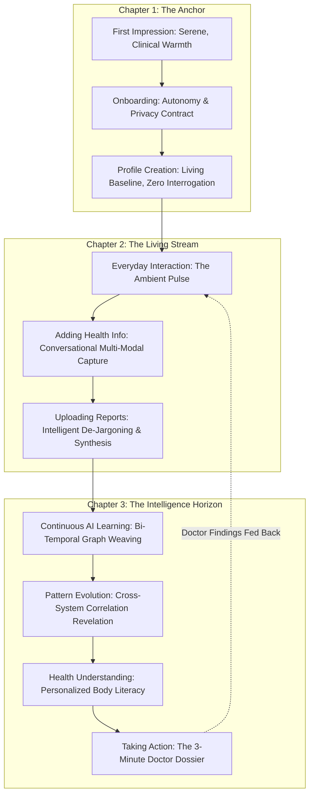

# CONTINUUM: End-to-End User Journey Architecture
## Designing the Continuous "Health Story" Experience
*Prepared for recHERsion 2026 National Hackathon*

---

## 1. Journey Philosophy: The "Health Story" Metaphor

Conventional health apps operate as **spreadsheets** or **transactional portals**. The user logs an entry; the entry sits in a row; the app forgets the emotional and physiological context.

In **Continuum**, health is designed as an unfolding, multi-chapter **Living Health Story**:
- Every lab result is an artifact.
- Every symptom is a sensory note.
- Every medical visit is a chapter marker.
- The AI acts as the **editorial biographer of her biology**—never judging, never fabricating, constantly weaving isolated sentences into coherent paragraphs.

---

## 2. The 10-Stage Journey Breakdown

### Stage 1: First Impression (The "I Am Seen" Threshold)
* **The Emotional Mindset:** The user arrives fatigued, often carrying years of medical dismissal ("It's just stress," "Your bloodwork is normal," "That's just womanhood"). She anticipates either a pink-themed period tracker or a cold hospital portal.
* **The Experience:**
  - An aesthetic of **clinical serenity**: deep warm undertones, editorial typography (refined serif paired with clean geometric sans-serif), calming spatial balance.
  - Zero pop-ups demanding cycle dates or push notification permissions.
  - A definitive core promise: *"Your body does not exist in isolated episodes. Let's listen to your complete story together."*
* **The Psychological Rationale:** Women don't need another app that infantilizes them with pastel florals or alarms them with medical jargon. The first 5 seconds must communicate: *This is a sanctuary of serious, dignified intelligence.*

---

### Stage 2: Onboarding (The Mindset Shift)
* **The Emotional Mindset:** Guarded. "Who is seeing my private hormonal data? Is this going to try to diagnose me with cancer?"
* **The Experience:**
  - **The Three Founding Pledges:**
    1. *We will never diagnose you:* "Diagnosis belongs to your doctor. Context belongs to you."
    2. *Your data is sovereign:* Client-side encrypted, never sold to third-party ad networks or brokers.
    3. *Zero tracking guilt:* "If you don't open this for three weeks, your story doesn't break. Life is irregular; we adapt to you."
  - The user selects her **current biological season** rather than filling out a rigid calendar:
    - *Exploring & Regulating* (Irregularity, cycle tracking, hormonal transitions)
    - *Investigating a Persistent Concern* (Pain, fatigue, unaddressed symptoms)
    - *Perimenopause / Menopause Transition*
    - *Postpartum & Recovery*
    - *General Longitudinal Longevity*
* **The Psychological Rationale:** Eliminating the "guilt loop" common to tracking apps. Traditional apps punish missed days; Continuum treats time gaps as natural rest periods.

---

### Stage 3: Health Profile Creation (The Living Baseline)
* **The Emotional Mindset:** Weary of filling out 40-field dropdowns of past surgeries and family histories that she can't fully recall.
* **The Experience:**
  - **Progressive Discovery (The "Blank Page" antidote):**
    - The platform asks for only **three foundational anchors**:
      1. Year of birth (Chronological baseline).
      2. Current primary hormonal state (Natural cycle, hormonal contraception, non-hormonal IUD, surgical menopause, etc.).
      3. One single sentence on what brought her here today: *"What is one thing about your body you wish someone had listened to?"*
  - The profile is treated as a *seed*, not a completed census. The system explicitly tells her: *"We will piece together your history organically as life happens."*
* **The Psychological Rationale:** Medical recall is notoriously flawed under interrogation. Allowing the profile to grow organically prevents abandonment and ensures higher data fidelity over time.

---

### Stage 4: Everyday Interaction (The Ambient Pulse)
* **The Emotional Mindset:** Busy, varying energy levels, low tolerance for cognitive friction.
* **The Experience:**
  - No 20-question questionnaires. 
  - Instead, the home view presents **"The Ambient Pulse"**:
    - A dynamic, breathing temporal card reflecting where she is in her biological phase (e.g., *"Cycle Day 19 • Mid-Luteal Phase"*).
    - A single low-friction prompt: *"How is your baseline today?"* with intuitive sensory states (Grounded, Drained, Inflamed, Restless, Clear).
    - If she taps "Clear" and closes the app in 4 seconds, her data point is captured and she leaves feeling accomplished.
* **The Psychological Rationale:** Sustainable engagement requires a 5-second floor and a 5-minute ceiling. If logging requires 3 minutes, retention plummets by day 14.

---

### Stage 5: Adding Health Information (Conversational Multi-Modal Capture)
* **The Emotional Mindset:** Experiencing an acute, confusing, or subtle symptom right now.
* **The Experience:**
  - She can tap a microphone icon or quick-note bar and speak freely:
    > *"I have had this throbbing migraine on the left side of my temple since 2 PM. Had two cups of matcha, but my lower back has that familiar heavy drag."*
  - **What the AI does immediately (The "Mirror Back" moment):**
    - Shows transparent entity extraction:
      - `Symptom`: Left temporal throbbing headache (Onset: Afternoon).
      - `Co-factor`: Lower back pelvic heaviness.
      - `Dietary Marker`: Matcha/Caffeine.
      - `Temporal Grounding`: Anchored to Day 24 (Late Luteal).
    - Gives her a gentle confirmation: *"Logged and anchored to your Luteal Day 24. We noticed this co-occurred with back heaviness once before in November."*
* **The Psychological Rationale:** Freeform speech feels therapeutic and human. By mirroring back the structured understanding without medical jargon, the user feels validated and heard.

---

### Stage 6: Uploading Reports (Intelligent De-Jargoning & Synthesis)
* **The Emotional Mindset:** Terrified by abnormal flags or confused by ambiguous lab reference ranges.
* **The Experience:**
  - She takes a photo of an old CBC report from 2024 or drops in a recent PDF thyroid panel from yesterday.
  - The engine parses values, standardizes units (LOINC), and translates the report:
    - **Demystifies Reference Ranges:** *"Your Ferritin is 18 ng/mL. While the laboratory considers anything over 12 'normal', optimal levels for cellular energy and hair vitality are typically above 45–50 ng/mL."*
    - **Links to Historical Baseline:** Shows her 2023 ferritin (32 ng/mL) alongside today’s (18 ng/mL), highlighting a multi-year decline that single-visit doctors miss.
    - **Explicit Non-Diagnostic Boundary:** *"This trend is an important biological observation to review with your clinician, not an emergency."*
* **The Psychological Rationale:** Lab tests are the greatest source of medical anxiety for patients. Converting numbers into longitudinal trends with respectful context replaces panic with calm clarity.

---

### Stage 7: AI Learning Continuously (The Bi-Temporal Graph Weaving)
* **The System Mechanics (Under the Hood):**
  - Every note, wearable sleep deviation, and blood biomarker creates nodes and directed edges in her **Bi-Temporal Knowledge Graph**:
    - `Event` $\rightarrow$ `Occurred At: Date`
    - `Event` $\rightarrow$ `Phase: Luteal Day 22`
    - `Event` $\rightarrow$ `Associated with: Ferritin Drift`
  - The AI runs background lag-correlation algorithms looking for subtle, multi-month connections across specialties (Endocrine $\leftrightarrow$ Dermatological $\leftrightarrow$ Gynecological).
* **The User Experience:**
  - The app doesn't send noisy daily notifications. 
  - Instead, once or twice a month, it presents a **"Story Convergence"**:
    *"Over the last 90 days, we've connected 14 observations. A clear rhythm is emerging."*
* **The Psychological Rationale:** Intelligence should feel thoughtful and deliberate, not hyperactive. High-frequency alerts induce notification fatigue; rare, profound syntheses build immense trust.

---

### Stage 8: Pattern Evolution (The "Aha!" Synthesis)
* **The Emotional Mindset:** Wondering if her symptoms are "all in her head."
* **The Experience:**
  - The user views her **Longitudinal Pattern Canvas**:
    - *Example Discovery:*
      > *"Cyclical Migraine vs. Deep Luteal Progesterone Drop"*
      > *"Over the past 6 months, 4 out of 5 of your severe headaches occurred between Cycle Days 24 and 26, coinciding with days where your resting heart rate dropped below 60 bpm. This suggests a neuro-hormonal pattern rather than random tension headaches."*
  - The user sees interactive, visual timelines where her lab values, symptoms, and cycle phases are overlaid harmoniously.
* **The Psychological Rationale:** This directly dissolves health gaslighting. Seeing concrete visual proof that her symptoms follow biological rhythms restores her trust in her own body.

---

### Stage 9: Health Understanding (Personalized Body Literacy)
* **The Emotional Mindset:** Empowered, curious, calm.
* **The Experience:**
  - The platform provides self-referential education:
    - Instead of generic articles like *"10 Causes of Brain Fog"*, Continuum generates:
      *"Understanding your brain fog: How your sleep architecture during your follicular phase buffers your energy vs. your luteal phase."*
  - It contextualizes her lifestyle experiments:
    - *"Since you increased magnesium intake 45 days ago, your recorded muscle tension notes on days 20–28 decreased from 6 instances to 1."*
* **The Psychological Rationale:** People do not want generic health advice; they want *their own biology explained to them*. Knowledge grounded in personal data creates lasting behavioral agency.

---

### Stage 10: Taking Action (The Empowered Clinical Encounter)
* **The Emotional Mindset:** Heading into a 15-minute consultation with a specialist. Anxious about forgetting details or being dismissed.
* **The Experience:**
  1. **Preparation:** She taps *"Prepare for Doctor Visit"* and selects the specialty (e.g., Endocrinologist, Gynecologist, or General Practitioner).
  2. **Generation:** Continuum generates the **3-Minute Doctor Dossier** (SBAR Format):
     - **Situation:** Primary longitudinal concern with onset timeline.
     - **Background:** Multi-year baseline of lab trajectories (e.g., Thyroid + Iron + Cycle variances).
     - **Assessment-ready Data:** Graph of symptom frequency mapped to biological phases.
     - **Objective Questions for the Physician:** 3 targeted, clinical-grade questions (e.g., *"Given the 18-month downward drift in ferritin alongside mid-luteal fatigue despite normal TSH, would an iron saturation and total iron-binding capacity (TIBC) workup be indicated?"*).
  3. **The Clinical Outcome:** 
     - The physician receives a structured, professional document that takes 90 seconds to read.
     - The consultation shifts from an adversarial struggle of memory reconstruction into a collaborative diagnostic inquiry.
  4. **The Closed Loop:** 
     - After the appointment, the user logs: *"Doctor ordered iron infusion and pelvic ultrasound for next month."*
     - The Story absorbs the outcome, closing the loop and preparing for the next chapter.
* **The Psychological Rationale:** This solves the fatal flaw of consumer health apps. If an app doesn't integrate into the reality of the 12-minute doctor consultation, it remains a toy. When it earns the doctor's respect, it becomes an indispensable lifeline.

---

## 3. The Unbroken Continuity Matrix

| Stage | User Input / Lived Reality | Continuum System Response | Evolution of Her "Health Story" |
| :--- | :--- | :--- | :--- |
| **1–3 (Anchor)** | Needs sanctuary; shares baseline season & primary concern. | Establishes cryptographic privacy, eliminates guilt, anchors baseline. | The story gets its title, theme, and first biological baseline coordinates. |
| **4–6 (Stream)** | Speaks quick sensory notes; uploads photos of dusty blood tests. | Extracts clinical entities; maps to bi-temporal graph; demystifies ranges. | The story adds authentic day-to-day dialogue and historical physical evidence. |
| **7–9 (Horizon)** | Lives life; reviews periodic syntheses. | Synthesizes cross-system patterns; tracks multi-month drifts. | The story reveals its hidden plotlines, recurring motifs, and biological rhythms. |
| **10 (Action)** | Prepares for a high-stakes clinical consultation. | Compiles physician SBAR dossier with evidence-backed consultation questions. | The story directly changes her clinical reality and accelerates diagnostic resolution. |
